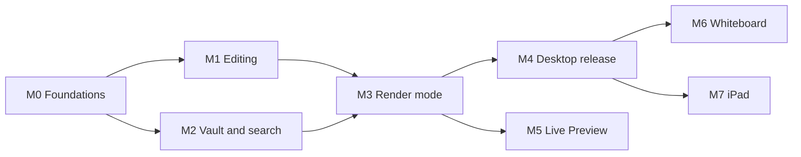

# Roadmap

Product milestones and the documentation that must land with each. A milestone is done when its
exit criteria hold and its docs are written. Decisions are summarized in
[AGENTS.md](../AGENTS.md); from M0 on, each gets an ADR.

## Documentation principles

- One topic per doc. AGENTS.md stays a concise index of decisions, invariants, and conventions;
  detail lives in `docs/`.
- Docs land in the same change as the behavior they describe. A stale doc is a bug.
- ADRs (`docs/decisions/NNNN-slug.md`) are append-only: supersede, don't rewrite.
- Contributor docs (`docs/`) and user docs (`docs/user/`) have different audiences; don't mix them.

## Planned docs

| Doc | Audience | Covers | Lands in |
|---|---|---|---|
| `README.md` | everyone | What buffer is, status, build and run | M0 |
| `CONTRIBUTING.md` | contributors | Toolchain, jj workflow, checks, applying the dependency policy | M0 |
| `docs/architecture.md` | contributors | Crate map, dependency rules, threading, frame loop, data flow | M0 |
| `docs/decisions/` | contributors | One ADR per AGENTS.md decision (backfilled), then one per new decision | M0, ongoing |
| `docs/performance.md` | contributors | Budgets, how to measure, baselines per milestone | M0 |
| `docs/editor/model.md` | contributors | Rope, transactions, selections, history, byte/grapheme rules | M1 |
| `docs/editor/keymaps.md` | contributors, users | Command registry, keymap format, Vim and Helix coverage matrices | M1 |
| `docs/config.md` | users | Config location, options, keymap overrides | M1 |
| `docs/vault.md` | contributors | Vault layout, note identity, link resolution, rename, external edits and conflicts, atomic saves, index cache | M2 |
| `docs/markdown-dialect.md` | users, contributors | Supported syntax; Obsidian compatibility matrix, including the typst-math divergence | M2 |
| `docs/search.md` | users, contributors | Query syntax (tags, text, fuzzy), index design | M2 |
| `docs/rendering.md` | contributors | Render tree, block and inline layout, caching, virtualization, Edit ↔ Render mapping | M3 |
| `docs/math.md` | users, contributors | Typst math primer for LaTeX users, World sandbox, caching, limits, error display | M3 |
| `docs/theming.md` | users | Theme format, fonts | M4 |
| `docs/user/` | users | Getting started, keybinding cheat sheets, coming from Obsidian | M4 |
| `docs/packaging.md` | maintainers | Release builds, size levers, per-OS packaging | M4 |
| `CHANGELOG.md` | everyone | Keep a Changelog, from the first release | M4 |
| `docs/live-preview.md` | contributors | Live Preview design, written before implementation | M5 |
| `docs/whiteboard.md` | contributors | Ink data model, file format spec, pen input pipeline, smoothing, embedding in notes | M6 |
| `docs/platforms/ipados.md` | contributors | iOS build, sandboxed vault access, touch/keyboard/Pencil input, app lifecycle | M7 |

## Milestones

M1 and M2 touch different crates and can run in parallel; M3 needs both.

### M0: Foundations

A workspace that builds, measures, and enforces the rules.

- Convert to a cargo workspace with the crate layout from AGENTS.md. `buffer-app` builds the
  `buffer` binary and opens an eframe/wgpu window.
- Add `LICENSE-MIT` and `LICENSE-APACHE`; set `license = "MIT OR Apache-2.0"`.
- Tooling: workspace lints, rustfmt and clippy config, `cargo deny` (licenses, advisories,
  duplicate versions), CI on Linux, macOS, and Windows.
- Baselines: cold start to first frame, idle CPU, RSS, binary size (release vs fat LTO; default
  vs trimmed wgpu backends), clean build time.
- Spike: typst math end to end (sandboxed World, raster to egui texture, cache, comemo eviction),
  measuring the real binary delta inside the app.

Exit: CI green on all three OSes; baselines recorded; ADRs backfilled.
Docs: `README.md`, `CONTRIBUTING.md`, `docs/architecture.md`, `docs/performance.md`,
`docs/decisions/`.

### M1: Text core and modal editing

- `buffer-text`: rope wrapper, transactions, selections, revision-tree history, grapheme-aware
  motions, text objects, registers, counts, repeat.
- `buffer-modal`: command registry, keymap engine, Vim and Helix presets, `:` command line,
  pending-key hints.
- Edit view: monospace, virtualized, Markdown syntax coloring, IME, clipboard (system, plus
  PRIMARY on Linux), in-note search.
- Single-file open and save: atomic writes, byte-identical round-trips.

Exit: both presets pass their key-sequence test tables; a 1 MB note meets the keystroke budget;
round-trip property tests pass.
Docs: `docs/editor/model.md`, `docs/editor/keymaps.md`, `docs/config.md`.

### M2: Vault, index, navigation

- Vault open: parallel scan, disposable index cache, notify watcher, conflict prompt.
- Extraction: tags (inline and frontmatter, nested), links and backlinks, headings, block ids,
  aliases.
- Quick switcher (frizbee over file names and aliases), tag browser and tag queries, full-text
  search, backlinks panel, new note, rename with inbound-link rewrite.

Exit: a synthetic 10k-note vault meets the open and search budgets; an Obsidian sample vault
opens and saves with no byte changes.
Docs: `docs/vault.md`, `docs/markdown-dialect.md`, `docs/search.md`.

### M3: Render mode

- Render tree with source ranges.
- Block layout: headings, lists, task lists, quotes, callouts, tables, footnotes, rules, code
  blocks (syntect), display math (typst).
- Own inline layout: emphasis, links, inline code, inline math, images.
- Keyboard navigation: scroll, heading jumps, link hints, follow and back (jump list). The
  Edit ↔ Render toggle preserves position.

Exit: toggle budget met; every render-view action is reachable by keyboard.
Docs: `docs/rendering.md`, `docs/math.md`.

### M4: Polish and first desktop release

- Themes and fonts, settings, accessibility pass (AccessKit), crash recovery for unsaved
  buffers, packaging for Linux, macOS, and Windows, release profile tuning.

Docs: `docs/theming.md`, `docs/user/`, `docs/packaging.md`, `CHANGELOG.md`.

### M5: Live Preview (optional)

Edit inside the render view, with raw source shown for the block under the cursor. Builds on
render-tree source ranges. Design doc first: `docs/live-preview.md`.

### M6: Whiteboard

- Freehand ink with pressure and tilt, pan/zoom canvas, eraser, lasso selection,
  perfect-freehand-style smoothing.
- Boards are notes: taggable, linkable, embeddable.
- Prerequisite: pen events, either from winit 0.31 reaching egui or from our own winit
  integration.

Docs: `docs/whiteboard.md`, plus an ADR for the file format.

### M7: iPad

- eframe iOS build (wgpu/Metal), vault access via Files and security-scoped bookmarks, touch and
  hardware keyboard, on-screen keyboard and IME, Apple Pencil for the whiteboard, save on
  suspend.

Docs: `docs/platforms/ipados.md`.

## Open questions

| Question | Decide by |
|---|---|
| Autosave policy (idle debounce, focus loss, or explicit `:w` only) | M1 |
| Where pasted images go (vault root, `attachments/`, honor Obsidian's setting) | M2 |
| Duplicate note names: resolution order and UI | M2 |
| Fonts: bundled vs system for UI, monospace, and typst (the math font alone is 1.3 MB) | M3 |
| Note transclusion (`![[Note]]`): depth limit, editing semantics | M3 |
| Typst beyond math (e.g. fenced `typst` blocks), now that the engine ships anyway | M3 |
| Migration aid for LaTeX math in imported Obsidian vaults | M4 |
| Whiteboard file format (taggable and linkable; sidecar vs embedded in `.md`) | M6 |
