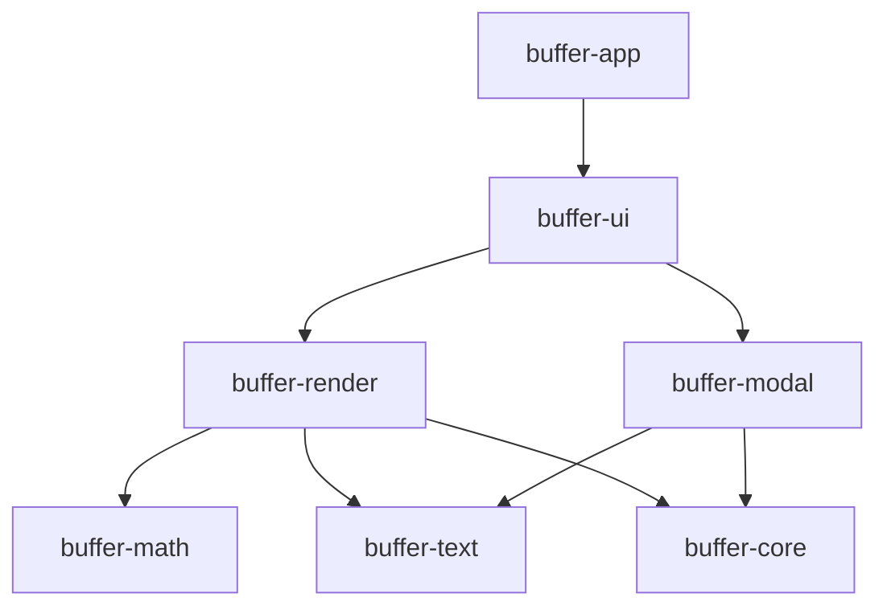
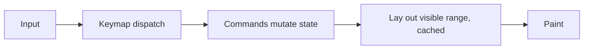

# Architecture

How buffer fits together: crates, dependency rules, threads, the frame loop, and data flow. The
decisions behind each part are in [decisions/](decisions/README.md); this doc shows how they
connect.

Status: the workspace and crate layout exist. `buffer-app` opens an empty window, and
`buffer-text` has text and change sets ([editor/model.md](editor/model.md)). Everything else here
is the target design.

## Crates

| Crate | Owns | egui, typst |
|---|---|---|
| `buffer-core` | Vault, note identity, Markdown + Obsidian extensions, frontmatter, index, search | never |
| `buffer-text` | Rope wrapper, transactions, selections, history, motions, text objects | never |
| `buffer-modal` | Modes, command registry, keymap engine, Vim and Helix presets | never |
| `buffer-render` | Render tree with source ranges, block and inline layout, paint | allowed |
| `buffer-math` | typst `World`, compile and raster, texture cache | allowed |
| `buffer-ui` | Editor view, render view, pickers, command line, status line | allowed |
| `buffer-app` | The `buffer` binary: eframe setup, config, platform glue | allowed |

Later: `buffer-ink` (whiteboard) and an iPad shell. See
[0025](decisions/0025-crate-architecture.md).

## Dependency rules

- Dependencies point down. Each crate's `Cargo.toml` declares exactly the edges above.
- core, text, and modal are pure: no egui, typst, or platform APIs, and their tests run without a
  GPU.
- `deny.toml` bans egui, eframe, and typst as direct dependencies outside render, math, ui, and
  app; a crate joins the ban's `wrappers` list when it starts using one. Transitive paths and
  platform APIs are left to review.
- Platform code lives in platform glue (`buffer-app` today). `unsafe` is denied workspace-wide;
  exceptions belong there, with `// SAFETY:` comments.
- Third-party versions live in the root `[workspace.dependencies]` with
  `default-features = false`; new crates follow the
  [dependency policy](decisions/0026-dependency-policy.md).

## Threads

No async runtime ([0020](decisions/0020-no-async-runtime.md)): std threads, channels, and rayon
for data-parallel work.

| Thread | Work |
|---|---|
| UI | egui frames: input, keymap dispatch, commands, layout of the visible range, paint |
| IO/index worker | Vault scan, parse, file watching, saves |
| Render workers | typst math, code highlighting, image decode |

- Workers post results over channels and call `ctx.request_repaint()` when results land.
- Background work reads text from rope snapshots: `crop` clones are cheap and copy-on-write
  ([0016](decisions/0016-crop-rope.md)).
- Render workers run under `catch_unwind`, and release builds keep `panic = "unwind"`, so a
  renderer bug can't take down unsaved text ([0023](decisions/0023-errors-panic-isolation.md)).

## Frame loop

- Key dispatch runs before egui widgets see input (`App::raw_input_hook` / start of `logic`).
  egui's Tab focus traversal and default clipboard shortcuts are disabled where they collide
  ([0018](decisions/0018-vim-helix-presets.md)).
- Every action is a named command, in the palette and bindable; mouse actions invoke the same
  commands.
- Per-frame work is O(visible): layout is virtualized and cached by (content hash, width, style,
  pixels-per-point). Nothing O(document) or O(vault) runs on the UI thread.
- Idle is free: frames run for input or landed results only. Animations use bounded
  `request_repaint_after`; there is no cursor blink by default.

## Data flow

### Vault

- Files are the truth ([0007](decisions/0007-files-are-the-truth.md)). Opening a vault scans it
  in parallel and parses each note with pulldown-cmark plus our Obsidian pass
  ([0011](decisions/0011-pulldown-cmark.md)) and the frontmatter reader
  ([0009](decisions/0009-frontmatter-reader.md)).
- Extraction feeds the in-memory index: file names, aliases, nested tags, links and backlinks,
  headings, block ids, and text ([0019](decisions/0019-search-index.md)). Any on-disk copy is a
  disposable, versioned cache.
- notify watches the vault, debounced ([0021](decisions/0021-file-watching.md)). Each change is
  reconciled by (mtime, size, hash): a clean buffer reloads in place and keeps its cursor; a dirty
  buffer gets a conflict prompt.

### Editing

- Text lives in a `crop` rope behind `buffer-text`. Positions are UTF-8 byte offsets, converted to
  chars, graphemes, or UTF-16 only at layout, IME, and platform boundaries.
- Commands apply transactions: a change set plus the resulting selections
  ([0017](decisions/0017-selection-based-core.md)). Selections map through changes; undo history
  is a revision tree.
- Saves are atomic (temp file in the same dir, fsync, rename) and run on the IO worker. Open +
  save without edits is byte-identical. Programmatic edits (tags, link rewrites on rename) patch
  byte spans.

### Rendering

- The render view builds a render tree whose nodes carry source byte ranges. The Edit ↔ Render
  toggle maps position through them, and Live Preview will build on them.
- Block and inline layout are ours ([0015](decisions/0015-own-inline-layout.md)): math, images,
  and chips sit inside lines, and text runs use egui fonts.
- Math ([0012](decisions/0012-typst-math.md)), code highlighting
  ([0013](decisions/0013-syntect-highlighting.md)), and images
  ([0014](decisions/0014-images.md)) render on workers into cached textures. typst's `World`
  exposes no files, packages, or network, and `comemo::evict` bounds its memo cache.
